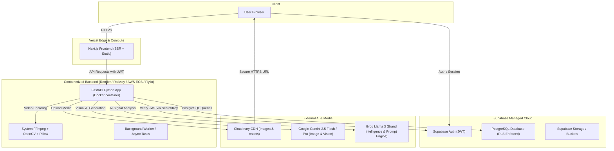

# GoVisual AI — Production-Readiness Review & Vercel Deployment Architecture

**Audit Date:** November 2026  
**Target Deployment Environment:** Vercel (Frontend & Serverless Execution)  
**Subject:** Review of Supabase failure-resilience implementation, JWT authentication security, serverless compatibility, and cloud database restoration.

---

## 1. Current Implementation Status

To mitigate the unexpected downtime of the remote Supabase project (`khlaifuochmzptckbzvb.supabase.co`), a local resilience layer was recently introduced across the frontend and backend:

1. **`backend/database/local_workspace_store.py`**: A JSON-backed file store (`local_workspace_store.json`) maintaining user accounts, brand profiles, product entries, library assets, and generation counts.
2. **`backend/services/auth.py`**: Fallback JWT decoder allowing request execution when Supabase Auth returns errors or 403.
3. **`backend/routes/onboard_routes.py`**: Added `/brand/onboard/sync` and fallback logic in `/identity` and `/save`.
4. **`frontend/components/providers/demo-session-provider.tsx` & `frontend/lib/supabase.ts`**: Persistent `localStorage` backups and auto-hydration hooks to bypass Supabase read failures.

While this setup allowed local development and demonstration testing to continue without a working cloud database, **it is fundamentally incompatible with production deployment on Vercel and introduces critical security and data-integrity risks**.

---

## 2. Vercel Compatibility Issues

### 2.1. Serverless Ephemeral & Read-Only Filesystem
* **The Problem**: In Vercel serverless execution (AWS Lambda underlying runtime), the entire deployment bundle filesystem is **read-only**.
* **Impact on `LocalWorkspaceStore`**:
  * In [backend/database/local_workspace_store.py](file:///c:/Users/HP/Downloads/GoVisualAI_new/backend/database/local_workspace_store.py#L32-L39), `_save_store()` attempts to write directly to `local_workspace_store.json` using `open(STORE_FILE, "w")`.
  * On Vercel, this will immediately throw:
    ```
    OSError: [Errno 30] Read-only file system: '/var/task/backend/database/local_workspace_store.json'
    ```
* **Impact on `/tmp`**:
  * Even if the JSON path was moved to `/tmp/`, `/tmp` in serverless is strictly ephemeral and scoped to a single execution instance. It is discarded when the function goes idle or scales down.
  * Different user requests hit different isolated serverless instances. Instance A would never see data saved by Instance B.

### 2.2. Generated Media Stored on Local Disk
* In [backend/routes/addon_routes.py](file:///c:/Users/HP/Downloads/GoVisualAI_new/backend/routes/addon_routes.py#L268-L285), photoshoot generation writes binary JPEG files directly to disk:
  ```python
  backend_gen_dir = os.path.join(backend_dir, "generated_images")
  frontend_gen_dir = os.path.join(root_dir, "frontend", "public", "static", "generated")
  ```
* On Vercel:
  1. Writing to `frontend/public/static/` or `backend/generated_images/` crashes due to the read-only filesystem.
  2. Static file mounting (`app.mount("/static/generated", ...)`) cannot serve dynamically created images in serverless because file persistence does not exist between lambdas.

### 2.3. Frontend Next.js Proxy Rewrites
* In [frontend/next.config.ts](file:///c:/Users/HP/Downloads/GoVisualAI_new/frontend/next.config.ts#L12-L17):
  ```typescript
  rewrites: async () => [
    {
      source: '/static/:path*',
      destination: 'http://127.0.0.1:8000/static/:path*',
    },
  ]
  ```
* On Vercel, `127.0.0.1:8000` does not exist. Any asset served through `/static/...` fails with HTTP 502 / connection refused.

---

## 3. Authentication Security Issues

### 3.1. Unverified JWT Decoding (Authentication Bypass)
* In [backend/services/auth.py](file:///c:/Users/HP/Downloads/GoVisualAI_new/backend/services/auth.py#L30-L55):
  ```python
  def decode_jwt_claims(token: str) -> dict:
      try:
          parts = token.split(".")
          if len(parts) >= 2:
              padding = "=" * ((4 - len(parts[1]) % 4) % 4)
              return json.loads(base64.urlsafe_b64decode(parts[1] + padding).decode("utf-8"))
      except Exception:
          pass
      return {}

  def get_current_user(...):
      ...
      except Exception as e:
          # Fallback when Supabase cloud is paused / unreachable
          claims = decode_jwt_claims(token)
          user_id = claims.get("sub") or claims.get("user_id")
          email = claims.get("email") or ""
          if user_id:
              return FallbackUser(user_id=user_id, email=email)
  ```
* **Critical Vulnerability**: `decode_jwt_claims` performs an unverified base64 extraction of the token payload without validating the cryptographic signature. Any unauthorized party can generate a fake JWT string containing `{"sub": "<target_user_uuid>", "email": "admin@company.com"}` with no valid signature, and the backend fallback will authenticate them as that user. No token expiration (`exp`) or audience (`aud`) checks are executed.

### 3.2. Unauthenticated Workspace Sync Endpoints
* In [backend/routes/onboard_routes.py](file:///c:/Users/HP/Downloads/GoVisualAI_new/backend/routes/onboard_routes.py#L135-L165):
  * The `/brand/onboard/sync` and `/brand/onboard/identity` routes use `optional_security = HTTPBearer(auto_error=False)`.
  * If a request provides no token, the endpoint falls back to an unauthenticated query parameter (`?email=...`). Anyone knowing an email can read or overwrite a user's entire brand profile, product list, and asset history.

---

## 4. Data Persistence & Synchronization Risks

### 4.1. Split-Brain State & Conflicting Sources of Truth
* When Supabase is paused, writes happen exclusively in browser `localStorage` and backend `local_workspace_store.json`.
* Once Supabase is restored, there is no reconciliation engine:
  * Updates made locally will be wiped or overwritten by stale database rows upon re-connection.
  * Conversely, database records may be overwritten by unauthenticated local states.

### 4.2. Session Bleeding on Shared Browsers
* In `frontend/lib/supabase.ts`, backup state is saved to `localStorage.setItem('govisual_user_data_latest', backupStr)`.
* If User A logs out and User B logs in (or an anonymous guest arrives), the application pulls `govisual_user_data_latest`, contaminating User B's session with User A's brand name, logo, and settings.

### 4.3. Hardcoded Heuristics
* In `LocalWorkspaceStore.get_brand`:
  ```python
  if "lakhankarani" in key:
      # matches any brand containing substring
  ```
* Such heuristics cause collisions if any second user with a similar email or business ID joins the platform.

---

## 5. Summary of Features Dependent on Local JSON Store

| Feature | Local Store Dependency | Production Replacement Required |
| :--- | :--- | :--- |
| **User Profiles** | `LocalWorkspaceStore.save_user`, `get_user` | Supabase table `user_profiles` |
| **Brand DNA** | `LocalWorkspaceStore.save_brand`, `get_brand` | Supabase table `brand_core_identity` |
| **Product Catalog** | Local workspace store & JSON fallback | Supabase table `brand_products` |
| **Generated Assets** | `LocalWorkspaceStore.save_library_asset`, `get_library_assets` | Supabase table `library_assets` / `generation_history` |
| **Photoshoot Assets** | Saved to local `generated_images/` & indexed in JSON | Cloudinary / Supabase Storage bucket |
| **Generation Counters**| `LocalWorkspaceStore.generation_counts` | Supabase table `credit_ledger` / `usage_tracking` |

---

## 6. Investigation of the Paused Supabase Project

* **Project URL**: `https://khlaifuochmzptckbzvb.supabase.co`
* **Error**: `HTTP 403: Request to ... on khlaifuochmzptckbzvb.supabase.co not allowed by policy`
* **Cause**: On Supabase Free Tier, projects are automatically paused after **7 consecutive days of inactivity**. When paused, the compute instance is stopped and all API gateways return HTTP 403.

### Steps to Restore:
1. Log in to the [Supabase Dashboard](https://supabase.com/dashboard).
2. Locate the project with reference ID `khlaifuochmzptckbzvb`.
3. Click the yellow or banner button: **"Restore Project"** / **"Resume Project"**.
4. Wait 1–3 minutes for the PostgreSQL instance to restart and health checks to turn green.
5. In Supabase Dashboard -> **Settings -> API**, confirm the following keys:
   * Project URL (`https://khlaifuochmzptckbzvb.supabase.co`)
   * `anon public` key
   * `service_role` secret
   * `JWT Secret` (required for backend signature verification)
6. Verify database schema: Check that the tables defined in `backend/database/migrations/` (`001_initial_schema.sql` through `007_billing_and_subscriptions.sql`) are present and migrated.

---

## 7. Backend Dependencies & Vercel Python Compatibility

A critical constraint for deploying the backend on Vercel Python Serverless Functions is the dependency and runtime profile:

```
fastapi
uvicorn
pillow
transformers       <-- INCOMPATIBLE (exceeds size limits)
torch              <-- INCOMPATIBLE (> 700MB+, exceeds 50MB/250MB Lambda bundle limit)
cloudinary
colorthief
moviepy==1.0.3     <-- INCOMPATIBLE (requires system FFmpeg binary)
imageio[ffmpeg]    <-- INCOMPATIBLE (requires system FFmpeg binary)
supabase
rembg              <-- INCOMPATIBLE (downloads 170MB U2Net model weights at runtime)
```

### The Incompatibilities:
1. **PyTorch & HuggingFace Transformers**:
   * PyTorch (`torch`) alone is over 700MB uncompressed.
   * Vercel Serverless Functions have a maximum uncompressed limit of **250MB** (and 50MB zipped). Deploying PyTorch directly on Vercel Serverless fails at build/packaging time.
2. **MoviePy & FFmpeg Video Generation**:
   * `moviepy` in [backend/services/addons/video_service.py](file:///c:/Users/HP/Downloads/GoVisualAI_new/backend/services/addons/video_service.py) requires an underlying `ffmpeg` binary. Vercel serverless environments do not have FFmpeg installed.
3. **Execution Timeouts**:
   * Video rendering (15–30s) and multi-shot AI image generation (15–45s) exceed Vercel Hobby limits (10 seconds) and push the boundary of Pro limits (60–300s).
4. **`rembg`**:
   * Dynamically fetches large neural net weights to `~/.u2net/` during the first invocation, leading to serverless cold-start timeouts and ephemeral disk quota exhaustion.

---

## 8. Recommended Production Architecture

To deploy GoVisual AI successfully, reliably, and securely, the recommended architecture is:



### Key Architectural Pillars:
1. **Frontend on Vercel**:
   * Next.js 15 runs natively and fast on Vercel.
   * Connects to Supabase Auth client-side.
   * Directs all API requests to the Python Backend via `NEXT_PUBLIC_API_URL` pointing to the containerized backend.
2. **Backend on a Container Platform (Railway, Render, or Google Cloud Run)**:
   * Packaged with Docker, giving full support for FFmpeg, Python dependencies, and memory limits needed for image compositing.
   * Eliminates Vercel's 50MB package limit and 10s execution timeout.
3. **Database & Auth on Supabase**:
   * Unpause and use the primary Supabase PostgreSQL instance.
   * All user profiles, brands, products, generation logs, and credit tracking live in PostgreSQL.
4. **Media on Cloudinary / Supabase Storage**:
   * All generated photoshoots, brand books, and images upload to Cloudinary or Supabase Storage.
   * The database stores immutable HTTPS URLs (e.g. `https://res.cloudinary.com/...`).
   * Zero dependence on local filesystem storage.
5. **Cryptographic JWT Authentication**:
   * Backend validates incoming tokens against `SUPABASE_JWT_SECRET` using `PyJWT` or `supabase.auth.get_user()`.
   * Unverified decoding is completely removed. Unsigned tokens are rejected with HTTP 401.

---

## 9. Required Action Plan (Pending User Approval)

| Priority | Action Item | Target Location |
| :---: | :--- | :--- |
| **P0** | **Restore Supabase Project** in Supabase Web Dashboard | `https://supabase.com/dashboard` |
| **P0** | **Fix JWT Verification**: Replace unverified decoding with cryptographic signature validation using `SUPABASE_JWT_SECRET` | `backend/services/auth.py` |
| **P0** | **Enforce Strict Route Protection**: Remove unauthenticated fallback parameters (`?email=`) from sync and profile routes | `backend/routes/onboard_routes.py` |
| **P1** | **Route Media to Cloudinary**: Ensure photoshoot and generation routes upload directly to Cloudinary and return CDN URLs | `backend/routes/addon_routes.py`, `backend/services/storage.py` |
| **P1** | **Deprecate LocalStore in Production**: Gate `LocalWorkspaceStore` strictly behind an explicit `ENVIRONMENT=local_development` flag, ensuring production queries hit Supabase PostgreSQL | `backend/database/local_workspace_store.py`, `backend/services/brand_brain_service.py` |
| **P1** | **Prepare Backend Dockerfile**: Containerize FastAPI with FFmpeg for deployment to Railway / Render / Cloud Run | Workspace root |
