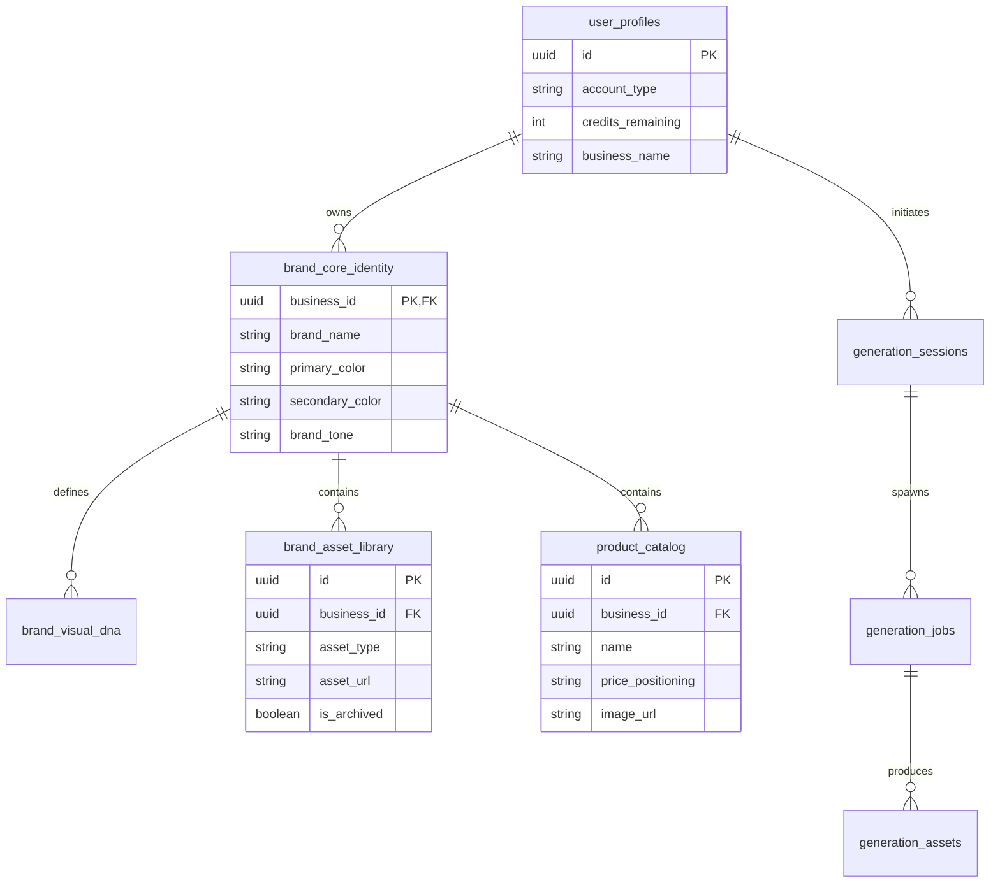

# GoVisual AI

GoVisual AI is an intelligent visual marketing and creative generation SaaS platform tailored for local Indian businesses and modern commercial brands. Starting from a business name, website URL, or Google Places profile, GoVisual AI automates the brand intelligence lifecycle—from brand extraction, brand book generation, and structured product catalogs to AI-driven social creative generation, reference-conditioned product photoshoots, animated video reels, micro-websites (minisites), and direct-to-Instagram publishing.

---

## Table of Contents

1. [Project Overview](#project-overview)
2. [Key Features & Implementation Status](#key-features--implementation-status)
3. [System Architecture](#system-architecture)
4. [Major Application Workflows](#major-application-workflows)
5. [Product Photoshoot Studio (Deep Dive)](#product-photoshoot-studio-deep-dive)
6. [Technology Stack](#technology-stack)
7. [Repository Structure](#repository-structure)
8. [Prerequisites](#prerequisites)
9. [Installation & Local Setup](#installation--local-setup)
10. [Environment Configuration](#environment-configuration)
11. [Running the Application](#running-the-application)
12. [API Reference](#api-reference)
13. [Database & Storage Architecture](#database--storage-architecture)
14. [AI Provider & Generation Pipelines](#ai-provider--generation-pipelines)
15. [Testing & Validation](#testing--validation)
16. [Security & Authorization](#security--authorization)
17. [Current Limitations & Known Issues](#current-limitations--known-issues)
18. [Development Roadmap](#development-roadmap)
19. [Contributing & Development Guidelines](#contributing--development-guidelines)

---

## Project Overview

Local businesses and independent merchants frequently struggle to create high-caliber marketing assets that preserve their exact product fidelity, maintain strict brand consistency (color palettes, logos, brand typography), and adapt across omni-channel campaigns (Instagram feed, reels, e-commerce storefronts).

**GoVisual AI** solves this through a modular, intelligence-driven visual production pipeline:
- **Zero-Friction Onboarding**: Ingests brand identity signals automatically from Google Places, external websites, or direct merchant input into a persistent Brand Brain.
- **Brand Identity & Brand Book**: Synthesizes full identity guidelines, including color schemes, tone, typography, and downloadable identity packs.
- **Reference-Conditioned Creative Engine**: Generates targeted promotional social creatives with automated product understanding, marketing planning, critic scoring, and logo compositing.
- **Virtual Product Photoshoot Studio**: Places physical products seamlessly into professional studio, lifestyle, or model-worn environments featuring validated Indian model personas or custom fictional adult models (age 18+).
- **Direct Publishing**: Bridges generated content to Meta / Instagram Professional accounts via secure OAuth and long-lived encrypted tokens.

---

## Key Features & Implementation Status

Features are categorized based on their verified status in the codebase:

| Category | Feature | Implementation Status | Notes |
| :--- | :--- | :--- | :--- |
| **Onboarding & Brand Intelligence** | Google Places & Web Signal Ingestion | **Implemented & Connected** | Extracts business name, category, photos, and dominant colors via Google Places API and ColorThief. |
| | Brand Brain Intelligence Analysis | **Implemented & Connected** | Multimodal analysis using Groq Vision/LLM or Gemini to derive brand tone, target audience, and styling guidelines. |
| | Brand Profile Editor & Workspace | **Implemented & Connected** | Interactive review, editing, and persistence of core brand identity and visual DNA in Supabase. |
| **Brand Book** | Comprehensive Brand Identity Kit | **Implemented & Connected** | Generates brand mission, color hex palettes, typography pairings, and copy guidelines using OpenAI GPT-4o-mini with category fallbacks. |
| **Product Catalog** | Product & Service Management | **Implemented & Connected** | Full CRUD API (`/api/products`), Supabase persistence, image uploads, and pricing tier metadata. |
| **Creative Generation** | V1 Generation Pipeline | **Implemented & Connected** | Legacy prompt assembly with T5 or Groq, fallback image generators, and Pillow watermarking. |
| | V2 Multi-Stage Creative Pipeline | **Implemented** | Includes Groq product understanding, creative planning, critic evaluation, and OpenAI/FLUX candidate generation. |
| | Generation Dispatch Engine (`/api/v1/generation`) | **Partially Implemented (Scaffolded)** | Job dispatch models and response contracts exist; background worker queue is mocked/in-progress. |
| **Photoshoot Studio** | Preset Indian Model Personas | **Implemented** | 6 curated Indian models (Aarav, Rohan, Kabir, Ananya, Meera, Isha) with dedicated visual reference assets. |
| | Custom Adult Model Creation (18+) | **Implemented** | Strict client/server validation (age 18+), persona synthesis, and local disk persistence. |
| | Visual Reference Separation | **Implemented** | Distinct multi-part payload passing product and model references independently to Google Gemini API. |
| | Google Image Generation API Call | **Implemented (NOT LIVE-VERIFIED)** | Full multimodal request payload implemented; live API calls not yet executed with paid credentials in testing. |
| | Authenticated Asset Saving | **Implemented & Connected** | Enforces Supabase JWT and business ownership checks; saves to `brand_asset_library` and local/Cloudinary storage. |
| **Video & Motion** | Static-to-Reel MP4 Generator | **Implemented & Connected** | Uses MoviePy and imageio-ffmpeg to create 9:16 reels with text animations and customizable background music. |
| **Minisites** | AI-Suggested Micro-Storefront | **Implemented & Connected** | Generates storefront copy and layout suggestions; serves slug-based JSON/previews (`/s/{slug}`). |
| **Instagram Direct** | OAuth & Token Encryption | **Implemented & Connected** | Meta Graph API OAuth with CSRF protection, Fernet 32-byte token encryption, and SQLite token repository. |
| | Direct Feed Publishing | **Implemented** | Publishes single photos to Instagram Business/Creator accounts via Meta Graph API container endpoints. |
| **Asset Library** | Workspace Asset Library | **Implemented & Connected** | Unified library view and state synchronization across creatives, brand books, photoshoots, and reels. |

---

## System Architecture

GoVisual AI is structured as a decoupled two-tier application:

1. **Frontend**: Next.js 16 (React 19) with Tailwind CSS v4, Zustand store, Framer Motion, Radix UI primitives, Lucide icons, and Supabase client-side authentication.
2. **Backend**: FastAPI (Python 3.10+) running asynchronously under Uvicorn, integrating database abstraction layers (Supabase PostgreSQL / local SQLite), AI orchestrators, image manipulation pipelines (Pillow, Rembg, ColorThief), and video renderers (MoviePy).

```mermaid
graph TD
    subgraph Client ["Frontend (Next.js 16 / React 19)"]
        UI[User Interface & Dashboard]
        Wizard[Onboarding / Brand Wizard]
        Studio[Content & Photoshoot Studio]
        Store[Zustand & DemoSession Context]
    end

    subgraph API ["Backend API Gateway (FastAPI)"]
        MainRouter["main.py Routing Hub"]
        OnboardRoute["/brand/onboard/*"]
        ProductRoute["/api/products/*"]
        V2Route["/generate (V2 Pipeline)"]
        AddonRoute["/api/photoshoot & /api/brandbook"]
        InstagramRoute["/api/instagram/*"]
    end

    subgraph CoreServices ["Backend Processing Services"]
        BrandExtract["Brand & Places Extractor"]
        PU["Product Understanding (Groq Vision)"]
        Planner["Creative Planner Engine"]
        Critic["GoVisual Critic Engine"]
        PhotoshootSvc["Photoshoot Service (Gemini Multimodal)"]
        VideoSvc["Video Reel Engine (MoviePy)"]
        StorageSvc["Storage Service (Local / Cloudinary)"]
        Crypt["Token Encryption (Fernet)"]
    end

    subgraph DataAI ["External Services & Persistence"]
        SupabaseDB[("Supabase PostgreSQL")]
        SQLiteDB[("Local SQLite (govisual.db)")]
        GooglePlaces["Google Places API"]
        GroqAPI["Groq Cloud API"]
        GeminiAPI["Google Gemini API"]
        OpenAIAPI["OpenAI API"]
        MetaAPI["Meta Graph API"]
    end

    UI --> Store
    Wizard --> OnboardRoute
    Studio --> AddonRoute
    Studio --> V2Route
    Studio --> ProductRoute
    Studio --> InstagramRoute

    OnboardRoute --> BrandExtract
    BrandExtract --> GooglePlaces
    V2Route --> PU --> GroqAPI
    V2Route --> Planner
    V2Route --> Critic --> GroqAPI
    AddonRoute --> PhotoshootSvc --> GeminiAPI
    AddonRoute --> VideoSvc
    AddonRoute --> StorageSvc
    InstagramRoute --> Crypt
    InstagramRoute --> MetaAPI

    ProductRoute --> SupabaseDB
    OnboardRoute --> SupabaseDB
    InstagramRoute --> SQLiteDB
```



---

## Major Application Workflows

### 1. Brand Onboarding & Brand Brain Creation
1. **Extraction**: User inputs a business query and city. The system queries Google Places to retrieve place IDs, addresses, photos, and categories.
2. **Signal Analysis**: `DataSourceService` downloads business photos and metadata. The `GroqVisionProvider` or `GeminiAnalyst` extracts dominant brand colors, industry keywords, and visual constraints.
3. **Review & Save**: The merchant refines their details in the Brand Profile Editor. Submitting the profile invokes `/brand/onboard/save`, writing the core identity to the `brand_core_identity` and `brand_visual_dna` tables.

### 2. Creative Generation V2 Pipeline
1. **Product Intake**: The user selects a product from the catalog or uploads an image with marketing parameters (mood, purpose, format, lighting).
2. **Product Understanding**: Groq Vision inspects the product image to identify category, physical attributes, color palettes, and focal points.
3. **Generation Planning**: `GenerationPlanner` merges product analysis, brand identity, and marketing objectives to produce 3 distinct candidate generation prompts.
4. **Candidate Generation**: The system submits requests to the configured image provider (OpenAI DALL-E, HuggingFace FLUX, or mock providers).
5. **Critic Scoring & Self-Correction**: When enabled (`ENABLE_CRITIC=true`), the `GoVisualCritic` evaluates generated candidates against brand DNA and visual quality rules.
6. **Caption & Watermarking**: An automated caption with relevant hashtags is created, and the brand logo is composited onto the final asset.

### 3. Product Photoshoot Studio Workflow
Detailed in the [Product Photoshoot Studio](#product-photoshoot-studio-deep-dive) section below.

### 4. Instagram Direct Publishing
1. **OAuth Connection**: The user initiates Instagram connection via `/api/instagram/connect`.
2. **Token Exchange & Encryption**: Meta redirects to `/api/instagram/callback`. The backend exchanges the authorization code for a long-lived user token, verifies Business/Creator account status, encrypts the access token using Fernet cryptography, and stores it in SQLite.
3. **Container Creation & Publishing**: When publishing a creative via `/api/instagram/publish`, the backend ensures the media URL is publicly reachable (uploading to Cloudinary if currently stored locally), creates a Meta Media Container, and triggers publishing.

---

## Product Photoshoot Studio (Deep Dive)

The Product Photoshoot Studio provides a virtual studio environment for e-commerce products. It produces high-resolution studio and lifestyle photography without requiring physical photography shoots.

### Photoshoot Modes
1. **AI Model Photoshoot (`mode="model"`)**: Showcases products naturally worn, held, or presented by an approved Indian AI model.
2. **Product Studio / No Model (`mode="product_only"`)**: Pure e-commerce packshot photography emphasizing neutral cycloramas, studio lighting, and zero human elements.
3. **Lifestyle Photoshoot (`mode="lifestyle"`)**: Places products in authentic real-world settings (e.g., modern apartments, urban streets, festive interiors), with human presence configurable via `includeModel`.

### Model Persona Architecture

#### Preset Model Personas
The system includes six pre-configured Indian model personas with dedicated high-resolution facial and styling references stored in `frontend/public/models/photoshoot/`:

| Model ID | Name | Gender | Style | Intended Use Case |
| :--- | :--- | :--- | :--- | :--- |
| `aarav` | Aarav | Male | Modern Commercial | Tech accessories, menswear, watches, urban lifestyle |
| `rohan` | Rohan | Male | Clean Professional | Corporate wear, executive grooming, luxury essentials |
| `kabir` | Kabir | Male | Bold Editorial | High-fashion apparel, bold jewelry, designer eyewear |
| `ananya` | Ananya | Female | Natural Contemporary | Skincare, cosmetics, everyday jewelry, casual & fusion wear |
| `meera` | Meera | Female | Elegant Luxury | Fine jewelry, bridal lehengas, silk sarees, luxury perfumes |
| `isha` | Isha | Female | Youthful Expressive | Trendy accessories, vibrant cosmetics, contemporary ethnic wear |

#### Custom Adult Model Creation (18+)
Merchants can register customized fictional adult models via `/api/photoshoot/custom-model`.
- **Strict Age Enforcement**: Both frontend and backend enforce an absolute minimum age of 18 (`age >= 18`). Requests below 18 are rejected with `400 Bad Request`.
- **Reference Preservation**: Supports uploading an optional model reference portrait.
- **Persistence**: Persists model metadata and reference images to `generated_images/custom_models/{model_id}/` to ensure availability across worker processes and restarts.

### Visual Reference Conditioning
The Google Gemini integration implements strict reference separation:
- **Part 1 (Product Reference)**: Sent as raw image bytes with MIME type `image/jpeg` or `image/png`. Marked explicitly in the system prompt as `REFERENCE 1 — AUTHORITATIVE CUSTOMER PRODUCT IMAGE`.
- **Part 2 (Model Reference)**: When in model mode, sent as a distinct second inline image part, designated `REFERENCE 2 — AUTHORITATIVE AI MODEL REFERENCE IMAGE`.
- **Prompt Isolation**: System instructions enforce strict preservation of product geometry, labels, and color while adapting the model's pose and composition to match the selected shot composition.

### Shot Compositions
Every photoshoot request automatically generates three coordinated compositions:
- **Model Mode**: Lifestyle Close-Up, Hero Showcase, Macro Detail.
- **Product Only Mode**: Product Hero, Detail Shot, Studio Setting.
- **Lifestyle Mode**: Contextual In-Use, Atmospheric Hero, Macro Lifestyle.

### Security, Ownership & Asset Persistence
- **Route**: `POST /api/photoshoot/save-asset`
- **Ownership Verification**: Requires Supabase authentication. Validates that the requesting `user.id` owns the `targetBrandId`. Rejects unauthorized cross-brand asset creation with `403 Forbidden`.
- **Storage**: Persists validated assets to Cloudinary or local disk, saving complete metadata records to the `brand_asset_library` table in Supabase.
- **State Synchronization**: Automatically reflects saved assets in the merchant's workspace dashboard and asset library via `DemoSessionProvider`.

> [!WARNING]
> **Status Notice: Photoshoot Image Generation Integration**  
> The backend orchestration, multi-part prompt construction, persona resolution, and error sanitization for Google Gemini are fully implemented and verified via automated mock tests (`backend/tests/test_photoshoot_service.py`). However, **the live Google Gemini image generation API endpoint has NOT been live-verified against paid production API credits**. Real product fidelity and model facial consistency remain subject to validation upon connecting active Google generative image credentials.

---

## Technology Stack

### Frontend
- **Framework**: Next.js 16.2.4 (React 19.2.5, App Router)
- **Language**: TypeScript 6
- **Styling**: Tailwind CSS v4, PostCSS
- **State Management**: Zustand 5.0.12, React Context (`DemoSessionProvider`)
- **UI Components & Icons**: Radix UI primitives, Lucide React, Framer Motion
- **Database & Auth Client**: `@supabase/supabase-js` 2.105.1

### Backend
- **Framework**: FastAPI 1.0.0 (Python 3.10+)
- **Server**: Uvicorn (ASGI)
- **Data Validation**: Pydantic v2
- **Image Processing**: Pillow (PIL), Rembg (background removal), ColorThief (palette extraction)
- **Video Rendering**: MoviePy 1.0.3, imageio-ffmpeg
- **Security & Cryptography**: Cryptography (Fernet symmetric encryption), HTTPBearer
- **Database Adapters**: Supabase Python SDK, Python standard `sqlite3`
- **HTTP Client**: HTTPX (asynchronous requests)

### Persistence & Storage
- **Primary Database**: Supabase PostgreSQL (managed relational store)
- **Local Embedded Database**: SQLite (`backend/govisual.db` for OAuth state and tokens)
- **Asset Storage**: Cloudinary (Cloud media management) with local fallback (`USE_LOCAL_STORAGE=true`)

### AI Models & Providers
- **Multimodal Understanding**: Groq Vision (`qwen/qwen3.8-27b`, `llama-3.2-11b-vision-preview`), Google Gemini 2.0
- **Language & Copywriting**: OpenAI (`gpt-4o-mini`, `gpt-3.5-turbo`), Groq (`openai/gpt-oss-120b`)
- **Prompt Optimization**: Local fine-tuned T5 model (`ml_model/`) or HuggingFace Transformers fallback
- **Image Generation Providers**: Google Gemini (Photoshoot Studio), OpenAI DALL-E / GPT-image, HuggingFace FLUX.1-schnell

---

## Repository Structure

```
GoVisualAI_new/
├── README.md                           # Master project documentation
├── package.json                        # Monorepo / root package definition (if present)
├── backend/                            # FastAPI backend application
│   ├── main.py                         # Application entry point & router mounting
│   ├── requirements.txt                # Python runtime dependencies
│   ├── .env.example                    # Backend environment template
│   ├── database/                       # Database migrations & local repositories
│   │   ├── migrations/                 # PostgreSQL schema migrations (001 to 006)
│   │   ├── govisual.db                 # SQLite local database
│   │   └── instagram_db.py             # SQLite token & state repository
│   ├── routes/                         # API route controllers
│   │   ├── addon_routes.py             # Photoshoot, brand book, minisite, video routes
│   │   ├── engine_routes.py            # V1 generation dispatch & status routes
│   │   ├── generation_routes.py        # Prompt engine processing routes
│   │   ├── instagram_routes.py         # Instagram OAuth & publishing routes
│   │   ├── onboard_routes.py           # Brand extraction & onboarding routes
│   │   ├── product_routes.py           # Product catalog CRUD routes
│   │   └── v2_routes.py                # V2 multi-stage creative pipeline routes
│   ├── services/                       # Business logic & AI orchestration
│   │   ├── addons/                     # Addon modules (photoshoot, brandbook, video, instagram)
│   │   ├── creative_engine/            # Generation planning & candidate preparation
│   │   ├── creative_planner/           # Creative direction planning
│   │   ├── critic/                     # Visual evaluation & scoring engine
│   │   ├── intelligence/               # Brand intelligence & vision analysts
│   │   ├── product_understanding/      # Multimodal product feature extraction
│   │   ├── prompt_engine/              # Prompt validation, assembly, and optimization
│   │   ├── self_correction/            # Regeneration & correction providers
│   │   ├── auth.py                     # Supabase authentication dependency
│   │   ├── brand.py                    # Google Places search & profile extraction
│   │   ├── image_gen.py                # Legacy multi-provider image generator
│   │   ├── storage.py                  # Local disk & Cloudinary storage service
│   │   ├── t5_model.py                 # T5 prompt transformer inference service
│   │   ├── token_encryption.py         # Fernet 32-byte encryption service
│   │   └── watermark.py                # Pillow watermarking & compositing
│   └── tests/                          # Automated backend test suite
│       ├── test_generation_engine.py   # Generation dispatch tests
│       ├── test_instagram_integration.py# Instagram OAuth & publishing tests
│       └── test_photoshoot_service.py  # Unit tests for Photoshoot Studio
├── frontend/                           # Next.js frontend application
│   ├── package.json                    # Node.js dependencies and scripts
│   ├── next.config.ts                  # Next.js configuration
│   ├── app/                            # Next.js App Router routes
│   │   ├── auth/                       # Sign in & sign up pages
│   │   ├── brandbook/                  # Brand book generator interface
│   │   ├── dashboard/                  # Merchant control center & metrics
│   │   ├── generation/                 # Creative generation workflow
│   │   ├── library/                    # Workspace asset library
│   │   ├── minisite/                   # Micro-website builder
│   │   ├── minisite-preview/           # Dynamic micro-website renderer
│   │   ├── onboard/                    # Multi-step brand onboarding flow
│   │   ├── photoshoot/                 # Product Photoshoot Studio interface
│   │   ├── products/                   # Product catalog management
│   │   ├── prompt-inspector/           # Prompt debugging & inspection tool
│   │   ├── results/                    # Generation results view
│   │   ├── settings/                   # Brand and account settings
│   │   ├── studio/                     # Content Studio canvas
│   │   ├── video/                      # Video reel generator
│   │   ├── wizard/                     # Legacy creative generation wizard
│   │   └── workspace/                  # Workspace overview
│   ├── components/                     # Reusable React components
│   │   ├── instagram/                  # Instagram publishing modals & components
│   │   ├── onboarding/                 # Onboarding steps & Brand Brain editors
│   │   ├── providers/                  # DemoSessionProvider & context wrappers
│   │   ├── studio/                     # Studio creative tools
│   │   └── ui/                         # Base UI widgets & design system
│   ├── lib/                            # API clients & state stores
│   │   ├── api.ts                      # Backend HTTP client
│   │   ├── productApi.ts               # Product catalog API client
│   │   ├── instagramApi.ts             # Instagram connection API client
│   │   ├── generationStore.ts          # Generation state store
│   │   ├── store.ts                    # Global application store
│   │   └── supabase.ts                 # Supabase client initialization
│   └── public/                         # Static assets
│       └── models/photoshoot/          # Preset model reference images & manifest
```

---

## Prerequisites

- **Node.js**: `v18.18.0` or higher (Node 20+ recommended)
- **Package Manager**: `npm` (v9+)
- **Python**: `3.10` or `3.11` (64-bit)
- **Virtual Environment**: Python `venv` or `conda`
- **FFmpeg**: Required on system PATH for MoviePy video generation (`imageio-ffmpeg` bundled as fallback)
- **Database**: Active Supabase project (for authentication and PostgreSQL persistence)

---

## Installation & Local Setup

### 1. Clone the Repository
```bash
git clone https://github.com/Lakhank123/GoVisual-AI.git
cd GoVisual-AI
```

### 2. Backend Setup
Navigate to the backend directory and set up a Python virtual environment:
```bash
cd backend
python -m venv venv

# On Windows:
venv\Scripts\activate

# On macOS/Linux:
source venv/bin/activate

# Install Python dependencies:
pip install -r requirements.txt
```

### 3. Frontend Setup
In a separate terminal, navigate to the frontend directory:
```bash
cd frontend
npm install
```

---

## Environment Configuration

Create `.env` in `backend/` and `.env.local` in `frontend/`. Refer to the documented variables below.

### Backend (`backend/.env`)

| Variable Name | Required / Optional | Purpose | Default / Example |
| :--- | :--- | :--- | :--- |
| `SUPABASE_URL` | **Required** | Supabase Project URL for database queries and auth | `https://xyzcompany.supabase.co` |
| `SUPABASE_KEY` / `SUPABASE_ANON_KEY` | **Required** | Supabase anonymous public API key | `eyJhbGciOi...` |
| `SUPABASE_SERVICE_ROLE_KEY` | Optional | Supabase admin service key for elevated backend migrations | `eyJhbGciOi...` |
| `GOOGLE_PLACES_API_KEY` | Optional | Google Places API key for brand extraction during onboarding | `AIzaSy...` |
| `GEMINI_API_KEY` | Optional | Google Gemini API key for Photoshoot Studio and multimodal analysis | `AIzaSy...` |
| `GEMINI_MODEL` | Optional | Default Gemini image generation model identifier | `gemini-2.0-flash-preview-image-generation` |
| `GEMINI_PHOTOSHOOT_MODEL` | Optional | Overriding model identifier for photoshoot generations | `gemini-nano-banana-2.1` |
| `OPENAI_API_KEY` | Optional | OpenAI API key for brand book generation and DALL-E image generation | `sk-proj-...` |
| `OPENAI_IMAGE_MODEL` | Optional | OpenAI image generation model | `gpt-image-1-mini` or `dall-e-3` |
| `GROQ_API_KEY` | Optional | Groq Cloud API key for fast vision analysis and critic scoring | `gsk_...` |
| `GROQ_VISION_MODEL` | Optional | Groq vision model name | `llama-3.2-11b-vision-preview` |
| `HF_API_TOKEN` | Optional | HuggingFace API token for FLUX.1-schnell fallback generation | `hf_...` |
| `IMAGE_MODE` | Optional | Explicit image engine mode selection (`openai`, `gemini`, `hf`, `mock`) | `mock` |
| `USE_LOCAL_STORAGE` | Optional | Save generated images to local disk (`generated_images/`) rather than cloud | `true` |
| `CLOUDINARY_CLOUD_NAME` | Optional | Cloudinary account cloud name (required if `USE_LOCAL_STORAGE=false`) | `your-cloud-name` |
| `CLOUDINARY_API_KEY` | Optional | Cloudinary API key | `1234567890` |
| `CLOUDINARY_API_SECRET` | Optional | Cloudinary API secret | `your-secret` |
| `TOKEN_ENCRYPTION_KEY` | Optional | 32-byte url-safe base64 key or passphrase for encrypting Instagram tokens | Base64 string |
| `META_APP_ID` | Optional | Meta App ID for Instagram Professional OAuth | `1234567890` |
| `META_APP_SECRET` | Optional | Meta App Secret for token exchange | `your-meta-secret` |
| `INSTAGRAM_REDIRECT_URI` | Optional | Registered OAuth callback URL | `http://localhost:8000/api/instagram/callback` |
| `FRONTEND_URL` | Optional | Allowed CORS origin for frontend | `http://localhost:3000` |
| `T5_MODEL_PATH` | Optional | Local filesystem path to trained T5 model weights | `./ml_model` |
| `WATERMARK_PATH` | Optional | Path to local watermark overlay image | `./watermark.png` |

### Frontend (`frontend/.env.local`)

| Variable Name | Required / Optional | Purpose | Default / Example |
| :--- | :--- | :--- | :--- |
| `NEXT_PUBLIC_API_URL` | **Required** | Base URL of the FastAPI backend | `http://localhost:8000` |
| `NEXT_PUBLIC_SUPABASE_URL` | **Required** | Supabase project URL | `https://xyzcompany.supabase.co` |
| `NEXT_PUBLIC_SUPABASE_ANON_KEY` | **Required** | Supabase public anonymous key | `eyJhbGciOi...` |

---

## Running the Application

### Starting the Backend
From the `backend/` directory with the virtual environment activated:
```bash
uvicorn main:app --reload --port 8000
```
- API Base URL: `http://localhost:8000`
- Interactive Swagger Documentation: `http://localhost:8000/docs`
- OpenAPI Specification: `http://localhost:8000/openapi.json`

### Starting the Frontend
From the `frontend/` directory:
```bash
npm run dev
```
- Web Application: `http://localhost:3000`

---

## API Reference

The backend exposes endpoints grouped into functional domains:

### 1. Brand Onboarding (`/brand/onboard`)
- `POST /brand/onboard/extract`: Ingests business signals in parallel across Google Places, URLs, or manual input.
- `POST /brand/onboard/analyse`: Analyzes aggregated signals with Groq/Gemini to produce structured brand DNA.
- `POST /brand/onboard/save`: Commits verified brand profile to Supabase `brand_core_identity`.

### 2. Creative Generation (`/generate` & `/generation`)
- `POST /generate` (V2 Pipeline): Runs end-to-end creative generation: product understanding, creative planning, candidate generation, critic evaluation, and logo compositing.
- `POST /generate-samples`: Creates instant teaser samples from business place photos during onboarding.
- `POST /generation/process`: Validates, assembles, and optimizes prompts using the T5 pipeline.

### 3. Product Photoshoot Studio (`/api/photoshoot`)
- `POST /api/photoshoot`: Accepts product reference image, product name, model ID, background ID, and mode (`model`, `product_only`, `lifestyle`). Generates 3 reference-conditioned photoshoot shots.
- `POST /api/photoshoot/custom-model`: Registers a custom fictional adult model (strictly age 18+).
- `POST /api/photoshoot/save-asset`: Authenticated endpoint verifying brand ownership and persisting approved photoshoots to `brand_asset_library`.

### 4. Product Catalog (`/api/products`)
- `GET /api/products`: Lists products for the authenticated merchant.
- `POST /api/products`: Creates a new product catalog item with price positioning and imagery.
- `GET /api/products/{id}`: Retrieves details for a specific product.
- `PUT /api/products/{id}`: Updates existing product attributes.
- `DELETE /api/products/{id}`: Removes product from catalog.

### 5. Brand Book & Media Addons (`/api/*`)
- `POST /api/brandbook`: Generates full brand guidelines, typography pairings, and color rules.
- `POST /api/video/generate`: Renders a 9:16 MP4 reel from a static creative with kinetic text overlays.
- `POST /api/minisite/ai-suggest`: Suggests micro-website taglines and product highlights.
- `POST /api/minisite`: Generates and persists micro-website configurations.
- `GET /s/{slug}`: Serves public micro-website payload by slug.

### 6. Instagram Publishing (`/api/instagram`)
- `GET /api/instagram/connect`: Initiates Meta OAuth flow with secure CSRF state generation.
- `GET /api/instagram/callback`: Handles OAuth redirect, verifies professional account status, and encrypts credentials.
- `GET /api/instagram/status`: Returns current connection status and connected Instagram account handle.
- `POST /api/instagram/publish`: Publishes approved creative directly to Instagram feed.
- `POST /api/instagram/disconnect`: Revokes and deletes stored Instagram credentials.

---

## Database & Storage Architecture

### Supabase Relational Schema (PostgreSQL)

The primary persistence layer uses Supabase PostgreSQL, structured across six migrations in `backend/database/migrations/`:



- **`user_profiles`**: Maps directly to Supabase Auth users; manages subscription tiers and generation credits.
- **`brand_core_identity`**: Single source of truth for business name, industry category, colors, and tone.
- **`brand_visual_dna`**: Font configurations, logo constraints, and layout guidelines.
- **`product_catalog`**: Merchant inventory, pricing tiers, and reference image URLs.
- **`brand_asset_library`**: Catalog of generated or uploaded assets (logos, creatives, photoshoots, reels).
- **`generation_sessions` & `generation_jobs`**: State tracking for multi-candidate generation jobs and audit logs.

### Row-Level Security (RLS)
PostgreSQL migrations define strict RLS policies ensuring users can only read and write records where `business_id == auth.uid()` or `user_id == auth.uid()`.

### Asset Storage
- **Local Mode (`USE_LOCAL_STORAGE=true`)**: Stores generated assets in `backend/generated_images/` and videos in `backend/generated_videos/`, mounted as static directories at `/static/generated` and `/static/videos`.
- **Cloud Mode (`USE_LOCAL_STORAGE=false`)**: Uploads assets to Cloudinary under folder prefixes `brands/{business_id}/`. Required when publishing directly to Instagram to ensure media URLs are publicly accessible to Meta's servers.

---

## AI Provider & Generation Pipelines

GoVisual AI leverages specialized AI providers across different functional domains:

| Domain | Provider | Model | Configuration | Verification Status |
| :--- | :--- | :--- | :--- | :--- |
| **Product Understanding** | Groq Vision | `llama-3.2-11b-vision-preview` / `qwen/qwen3.8-27b` | `GROQ_API_KEY` | Implemented & verified |
| **Brand Signal Analysis** | Groq / Gemini | `openai/gpt-oss-120b` or Gemini 2.0 | `GROQ_API_KEY` / `GEMINI_API_KEY` | Implemented & verified |
| **Prompt Assembly & Optimization** | Local T5 | Fine-tuned weights in `backend/ml_model/` | `T5_MODEL_PATH` | Implemented & verified |
| **Creative Generation (V2)** | OpenAI / HF | `gpt-image-1-mini` or FLUX.1-schnell | `OPENAI_API_KEY` / `HF_API_TOKEN` | Implemented (mocked in default tests) |
| **Creative Critic & Quality** | Groq Critic | `llama-3.2-11b-vision-preview` | `GROQ_API_KEY`, `ENABLE_CRITIC` | Implemented & verified |
| **Brand Book Copywriting** | OpenAI | `gpt-4o-mini` | `OPENAI_API_KEY` | Implemented with static fallbacks |
| **Product Photoshoot Studio** | Google Gemini | `gemini-nano-banana-2.1` / `gemini-2.0` | `GEMINI_API_KEY` | **Implemented (NOT LIVE-VERIFIED)** |

---

## Testing & Validation

The test suite validates business logic and service contracts using unit tests with mock providers.

### Test Suites

```
backend/tests/
├── test_photoshoot_service.py      # 27 unit tests validating Photoshoot Studio
├── test_instagram_integration.py   # 16 unit tests for OAuth, encryption & publishing
└── test_generation_engine.py       # Generation dispatch API contract tests
```

### Running Tests
To run the automated test suite without consuming external API credits:
```bash
cd backend
pytest tests/ -v
```

To run a specific test suite:
```bash
# Photoshoot Studio tests:
pytest tests/test_photoshoot_service.py -v

# Instagram integration tests:
pytest tests/test_instagram_integration.py -v
```

> [!NOTE]
> All existing test suites in `backend/tests/` use `unittest.mock` and `AsyncMock` to simulate external HTTP responses from Google, Meta, and OpenAI. Passing tests confirm architectural correctness, prompt formatting, payload structure, and error handling, but **do not represent live end-to-end verification against live third-party APIs**.

---

## Security & Authorization

1. **Authentication**: Handled via Supabase JWT Bearer tokens. The backend dependency `get_current_user` in `backend/services/auth.py` validates tokens via the Supabase client.
2. **Authorization & Brand Ownership**: Mutating operations (e.g., saving photoshoot assets, modifying product catalogs) verify that the authenticated `user.id` matches the target `business_id`. Cross-brand writes are rejected with `403 Forbidden`.
3. **Secret Protection**:
   - Environment templates (`.env.example`) contain no real credentials.
   - Sensitive Meta user access tokens are encrypted at rest using Fernet symmetric 32-byte encryption before storage in `govisual.db`.
   - Error messages returned to clients are scrubbed via `sanitize_error()` to remove API keys, bearer tokens, and internal filesystem paths.
4. **Safety & Compliance (Photoshoot Studio)**:
   - Fictional adult model creation strictly rejects models under 18 years of age.
   - Presets utilize synthetic 3D-generated adult personas.
5. **Instagram OAuth CSRF Defense**: OAuth state parameters use 32-byte cryptographically secure random tokens (`secrets.token_urlsafe(32)`), stored with short-lived expiration and single-use consumption.

---

## Current Limitations & Known Issues

1. **Photoshoot Live Verification**: The Google Gemini image generation integration for the Photoshoot Studio is fully implemented, but has not yet been executed against a live Google Gemini billing endpoint with valid credentials. Real-world visual quality, product fidelity, and model consistency remain unverified in production.
2. **Generation Dispatch Engine**: The asynchronous job dispatch pipeline in `routes/engine_routes.py` (`/api/v1/generation/*`) returns mocked job IDs and manifests. A Celery or Redis background worker queue is not yet integrated.
3. **Local Storage for Instagram Publishing**: Instagram's Graph API requires publicly accessible image URLs. Publishing images stored locally (`USE_LOCAL_STORAGE=true`) requires configuring Cloudinary or an equivalent public storage bucket.
4. **Minisite Persistence**: The micro-website builder currently writes generated website metadata to local JSON files (`minisites/{slug}.json`) rather than Supabase tables.

---

## Development Roadmap

- [x] **Module 1**: Core architecture, FastAPI backend, Next.js frontend, and Supabase schema design.
- [x] **Module 2**: Brand onboarding engine, Google Places extraction, and Brand Brain analysis.
- [x] **Module 3**: T5 prompt optimization engine and Prompt Inspector interface.
- [x] **Module 4**: Product catalog CRUD and merchant workspace synchronization.
- [x] **Module 5**: Addon services — Brand book generator, MoviePy video reel generator, and AI Minisites.
- [x] **Module 6**: Photoshoot Studio — Multi-mode architecture (Model, Product Only, Lifestyle), 6 preset Indian models, adult model registration (18+), and asset library saving.
- [x] **Module 7**: Meta / Instagram Graph API direct publishing integration with Fernet token encryption.
- [ ] **Phase Next**: Live verification of Google Gemini image generation with production credentials.
- [ ] **Phase Next**: Distributed task queue (Celery/Redis) for generation job dispatching.
- [ ] **Phase Next**: Database-backed persistence for Minisites in Supabase.

---

## Contributing & Development Guidelines

1. **Branching Strategy**: Create feature branches from `main` using descriptive names (e.g., `feature/photoshoot-live-eval`, `fix/token-refresh`).
2. **Code Style**:
   - **Frontend**: Follow Next.js App Router conventions. Run `npm run lint` before committing.
   - **Backend**: Adhere to PEP 8 standards. Use Pydantic models for request/response validation and type annotations for all service functions.
3. **API Keys & Secrets**:
   - Never commit `.env` or `.env.local` files.
   - Do not log raw API keys, bearer tokens, or user credentials.
   - Always run error messages through `sanitize_error()` before returning them in API responses.
4. **Testing Policy**: Ensure any new service logic is accompanied by unit tests in `backend/tests/`. Keep external network calls mocked to avoid consuming third-party API credits during continuous integration.
